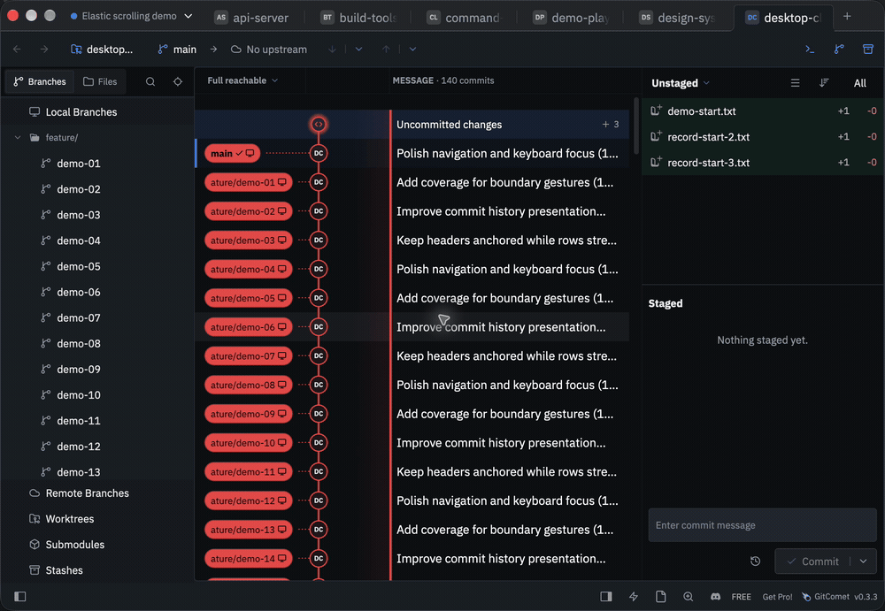
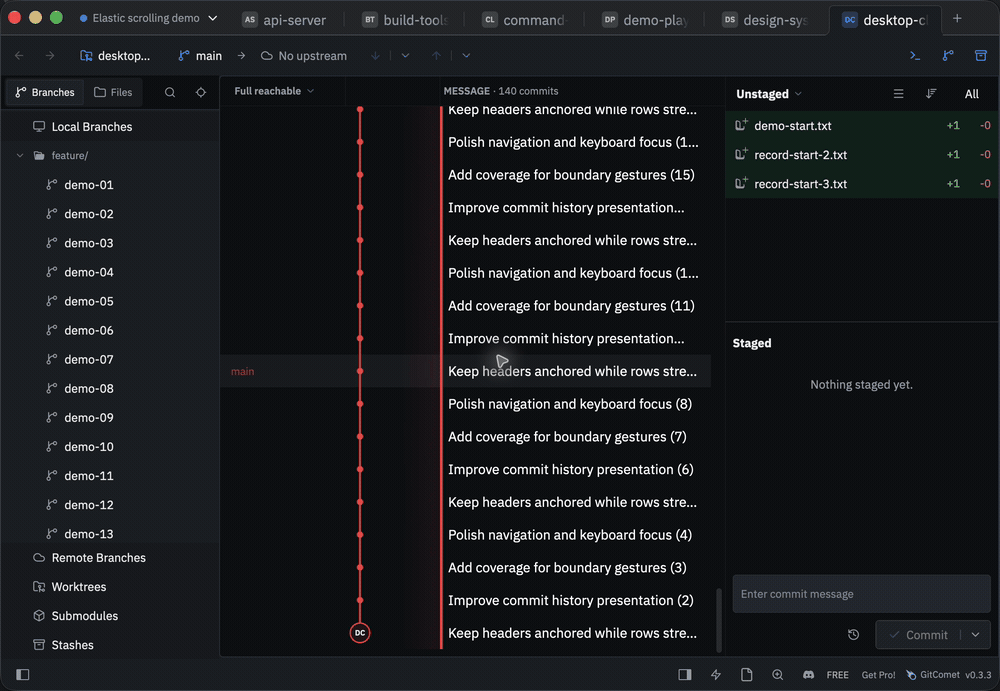

# GitComet elastic-scrolling demonstration

Actual screen recordings of the installed macOS GitComet development release, using fixture-only repositories and authors. These are not rendered mockups. The application scenario driver supplied touch-phase scroll packets through the real scrolling implementation; this is not a recording of physical trackpad input.

## Top edge

## Bottom edge

The clips show commit history. The implementation also covers shared lists and pickers, repository and terminal tab strips, diffs and previews, menus and Settings, editors and normal terminal scrollback. See [the coverage inventory](https://github.com/wowlocal/GitComet/blob/dcd8a76eccb5af970d72526b3a46baf3af887646/docs/macos-elastic-scroll-coverage.md) for source locations and exclusions. Source coverage does not establish physical-trackpad validation of every surface.

[Feature request #743](https://github.com/Auto-Explore/GitComet/issues/743) · [Draft implementation #742](https://github.com/Auto-Explore/GitComet/pull/742)

Recorded on 2026-11-09 with ScreenKite from local release `fe34d0636fe35af0ccbc693ce2b0861499a003c9`. That installed comparison build includes separate private framework pacing changes which are not part of #742. GIFs trimmed outside the ScreenKite project with ffmpeg, 30 fps, no audio. The public implementation head is `dcd8a76e` and remains a draft requiring rebasing. Recording, trimming and this description were assisted by OpenAI Codex at the reporter's request.
