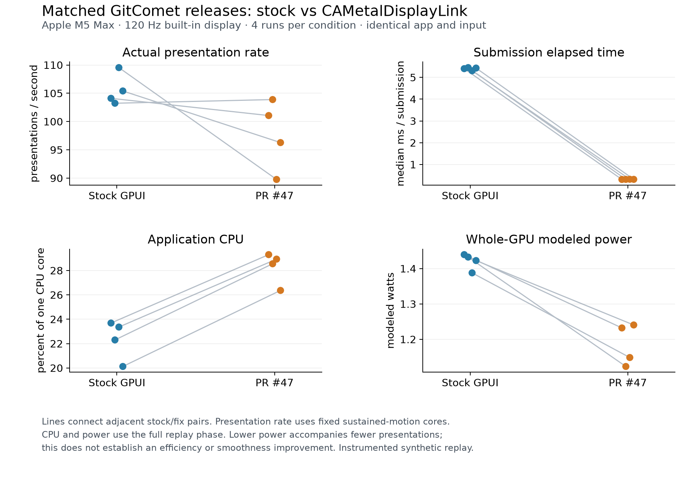

# Stock versus CAMetalDisplayLink in GitComet

Controlled follow-up to [Havunen's request](https://github.com/Auto-Explore/GitComet/issues/741#issuecomment-6745124901), measured November 9, 2026. The framework draft is [Havunen/gpui-ce#47](https://github.com/Havunen/gpui-ce/pull/47).

**This comparison does not establish a smoothness improvement.** The backport substantially shortens elapsed submission duration, but successful presentation rate is lower in three of four adjacent pairs and application CPU is higher in all four. It should remain a draft while presentation behavior and lifecycle QA are investigated.



## Results

Each cell is the median of four run-level measurements, followed by the observed range. Individual frames are not independent experimental replicates. “Submission” is elapsed duration of the CPU-side submit path, including time blocked in drawable acquisition; it is not CPU execution time, and its reduction alone does not prove faster display presentation.

| Measurement | Stock GPUI | PR #47 |
| --- | ---: | ---: |
| Actual presentations/s in sustained-motion cores | 104.8 (103.2–109.5) | 98.7 (89.8–103.9) |
| Per-run p95 actual presentation interval | 16.667 ms (16.667–16.667) | 16.667 ms (16.667–16.667) |
| Median CPU-side submission duration | 5.415 ms (5.304–5.449) | 0.316 ms (0.312–0.321) |
| Application CPU, percent of one core | 22.83% (20.12–23.69) | 28.74% (26.36–29.30) |
| Application GPU execution, ms/wall-second | 74.9 (72.4–79.4) | 45.8 (45.5–51.6) |
| WindowServer GPU execution, ms/wall-second | 453.3 (444.5–478.0) | 515.8 (455.4–535.8) |
| Whole-GPU modeled power | 1.428 W (1.388–1.439) | 1.190 W (1.123–1.241) |
| Whole-GPU modeled power, idle before | 0.109 W (0.057–0.123) | 0.063 W (0.057–0.146) |
| Whole-GPU modeled power, idle after | 0.096 W (0.060–0.112) | 0.076 W (0.059–0.113) |

The largest observed intra-core interval was 16.671 ms for stock and 20.833 ms for the draft. With the predefined cutoffs of 16.916667, 25.25 and 33.583333 ms, stock had zero exceedances and the draft had one at the first cutoff, zero at the others. A 16.67 ms gap still spans two nominal 120 Hz periods; these cutoffs count longer stalls, not every missed refresh opportunity.

| Planned ordinal | Build | Presentations/s, cores | p95 gap, ms | CPU, % one core | App GPU, ms/s | Whole GPU, modeled W | Zero/nonpresent callbacks, full phase |
| --- | --- | ---: | ---: | ---: | ---: | ---: | ---: |
| 1 | Stock | 104.10 | 16.667 | 23.69 | 79.44 | 1.439 | 0/1280 |
| 2 | PR #47 | 101.06 | 16.667 | 29.30 | 46.02 | 1.232 | 207/1408 |
| 3 | PR #47 | 103.89 | 16.667 | 28.55 | 45.49 | 1.123 | 190/1412 |
| 4 | Stock | 103.23 | 16.667 | 22.30 | 75.78 | 1.432 | 0/1242 |
| 5 | PR #47 | 89.76 | 16.667 | 28.93 | 51.62 | 1.149 | 358/1414 |
| 6 | Stock | 109.54 | 16.667 | 23.36 | 74.06 | 1.388 | 0/1303 |
| 7 | Stock | 105.41 | 16.667 | 20.12 | 72.42 | 1.423 | 0/1245 |
| 8 | PR #47 | 96.28 | 16.667 | 26.36 | 45.52 | 1.241 | 202/1412 |

Full-phase submission callbacks with zero/nonpresent timestamps total **0/5070 stock and 957/5646 draft**. There are no missing presentation callbacks, missing GPU completion callbacks or GPU completion errors in those windows. These are submitted-drawable outcomes, not automatically counts of perceptible dropped frames. These outcomes were retained; they were not used to reject runs. Actual cadence uses unique positive drawable `presentedTime` values, never the callback arrival time. Full-phase counts and primary cadence cores have different scopes.

Adjacent paired draft-minus-stock presentation rates are **−3.04, +0.65, −19.78 and −9.13 presentations/s**. Whole-GPU modeled power is lower in all four pairs, but fewer presentations accompany that decrease. This does not establish efficiency at equal output, an application-specific watt saving, GPU saturation or a battery-life improvement. IOKit execution time is not percentage of peak compute capacity. WindowServer and whole-GPU counters include desktop work.

After scrolling, application GPU execution was zero in all stock runs and three draft runs; the remaining draft run was 0.170 ms/wall-second. Parent observer CPU was 1.25–1.31% of one core. This excludes child-process work; the shared 1 Hz process guard also invokes `ps`. UI-probe work is included in application CPU. Neither observer cost nor background device energy is silently subtracted.

## Matched sources and environment

- Common application: GitComet `ad5df1d185c1a8805870bffcfde592d5e3ce355a`.
- Stock framework: `c55d73659dd6560d3e70281056f841e6d366c0e5`.
- Draft framework: `aad11809345380e3ae2d79f6cfcfc5aaf2af4edc`, exactly the one-commit PR #47 change on that base.
- Apple M5 Max; macOS 27.2 (26B123); built-in 1728×1117 logical display, 3456×2234 pixels, 2×, nominal 120 Hz. AC power, Low Power Mode off, thermal state nominal in every recorded witness.
- Same 1714×1037 outer window; history viewport 1095×882 logical points. Same copied 264-repository session, one repository's contents loaded. Same selected repository HEAD/status/index identity throughout; private repository/session contents are not distributed.
- Same standard release settings: Rust 1.99.1, opt-level 3, fat LTO, one codegen unit, features `ui-gpui,gix`. Identical nonbinary bundle resources and signing settings. Builds used at most four background jobs and were complete before measurements.
- No frame-rate/latency override, app draft #742 production changes, active game, simultaneous build, accessibility inspection, screen recording or Instruments capture during numeric measurements. Caffeinate settings were identical throughout.

Both are **instrumented release builds**: identical opt-in timing hooks, 4 ms UI-probe pings and bounded synthetic replay were added to both. Instrumentation can affect scheduling. These are not untouched shipping releases, physical trackpad trials, measurements of the separately installed combined build, or measurements of Zed's original implementation. The comparison isolates this framework backport and does not measure the app-side elastic scrolling draft.

An independent source review removed the observer in memory and reconstructed both exact production source trees across 24 byte-exact checks. The common app source files and recorder/handler blocks also match byte for byte. See [source equivalence](instrumentation-parity.json), [build identity](build-identity.json), the common app patch and the two framework patches. Both framework patches apply to the stock `c55d7365` base; the fixed patch includes the PR's production change.

## Workload and attempt accounting

The protocol and metric definitions were fixed before runtime. Each run restored a fresh copy of the profile, waited for indexed readiness, reset position, idled 12 seconds, prefilled the same history position, ran two alternating warm-ups, then four alternating measured plans and a 27-second idle tail. Automatic fetches, activation-time tag fetches and update checks were disabled only in the copied profiles. The real profile stayed unchanged during the runs.

Each plan replays 240 scheduled pixel-delta packets through GPUI's input route. It is synthetic input without AppKit gesture/momentum phases. All six plans alternate the same logical endpoints, 2000→5468→2000 pixels. Each valid run contains 1440 packet markers and 960 measured input stages; captures completed with zero dropped records/marker overflows and no actual native scroll input. Maximum CA/Unix clock-mapping residual across valid runs was 0.161 ms. Logical endpoints validate workload travel, not raster-motion consistency or perceived feel.

Primary cadence uses eight source-defined sustained-motion cores totaling 4.601196 seconds per run, selected from the fixed input plan before results. They cover 87.7% of displacement and 39.2% of plan time, excluding intentional pauses and slow tails. No interval is joined across separate cores. All cores retain their exposure, including sparse/empty ones. Full-phase cadence remains descriptive. CPU/energy use the full replay phase with contiguous 1 Hz intervals; phase scopes, cutoffs and interpolated quantiles are documented in [PROTOCOL.md](PROTOCOL.md).

**All attempts are accounted for:** three excluded pilots (one stock success, one draft startup-focus failure, one unchanged draft success); then the balanced eight valid runs in A B B A B A A B order, plus one failed first attempt at draft ordinal 3. Both failures timed out before measured scrolling while waiting for GPUI's internal active-window state, despite native frontmost-application/onscreen witnesses. The unchanged binaries passed their retries. The cause is unresolved: frontmost application does not prove `NSWindow.isKeyWindow`, so these records do not establish either environmental contamination or a PR defect. Native/cached focus needs dedicated lifecycle instrumentation.

The balanced series paused after that failed ordinal 3 while the other agent completed a brief local test pass; there were no simultaneous builds during any valid measurement. Added orchestration-only resume retains the failed attempt and retries the same condition before advancing. Binary hashes, metric definitions, input and acceptance checks were unchanged. The first two valid runs remain in the dataset. The comparison is conditional on successful matched foreground setup; the startup failures remain a separate limitation. The four predeclared adjacent pairs are (1,2), (3,4), (5,6), (7,8).

## Recompute and inspect

From this directory, with Python 3:

```sh
python3 analyze.py manifest.json
```

This regenerates the full analysis and each valid run's analysis from the included raw numeric traces and counter samples. The public export reproduces every numerical result from the local original exactly. `plot.py` regenerates the graphic with Matplotlib.

The per-attempt directories include selected application timing events, complete numeric native capture, 1 Hz measurement samples and input scenario. `pilot-attempts.json` records every excluded pilot. Session files, private repository content/identities, unrelated application events and stderr are omitted; repository witnesses use a literal placeholder and power-source strings are reduced to AC/Battery. The supplied patches preserve the measured source differences. `acquisition-reference/` contains the acquisition code for audit with machine-specific paths and signing identity replaced by placeholders; it requires local paths and a private/fresh test profile to rerun, and is not a one-command reproduction of the private workload.

Protocol, source parity, script bookkeeping and raw arithmetic were independently reviewed by another Codex agent. No statistical significance or population-wide effect is claimed from four serial runs per condition. Assistance, experiments, code and report by OpenAI Codex at the reporter's explicit request. Original CAMetalDisplayLink implementation credit remains with Steve Shreeve and Anthony Eid in Zed #65472.
