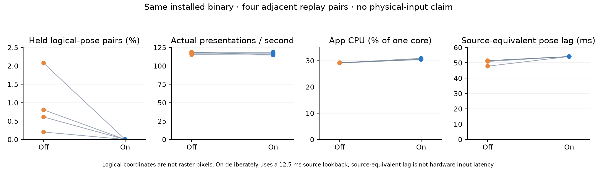

# Native history momentum: same-binary comparison

In this recorded-input replay, resampling removed sparse repeated logical positions during sustained momentum. It did **not** increase actual presentation cadence. App CPU increased in every pair, and the controller deliberately uses a **12.5 ms source lookback**. These results do not establish physical trackpad feel, raster smoothness, stable 120 Hz, or lower total energy consumption.

Eight serial runs used the same installed instrumented release binary, with resampling Off/On in ABBA BAAB order. Each fresh copied profile contained 264 open repositories, with one selected repository loaded. Four adjacent pairs are the experimental replicates. Input, phase metadata, captured source-age metadata, window, display, repository and binary were held fixed. Effective source ages vary with dispatch lateness and remain recorded outcomes. The primary exposure is eight predeclared momentum-only windows totaling 4.251708 seconds per run; CPU/GPU telemetry covers the broader scrolling phase.

Values below are the median of four run-level measurements per mode. All per-run ranges, paired contrasts, full windows, outcomes and coverage are retained in the [independent report](final-review.md) and [machine-readable reanalysis](analysis.json).

| Metric | Off | On |
| --- | ---: | ---: |
| Actual unique presentations/s, motion cores | 117.95 | 116.19 |
| p95 actual presentation gap | 8.333 ms | 8.333 ms |
| p99 actual presentation gap | 16.667 ms | 16.667 ms |
| Held logical-position pairs | 0.71% | 0% |
| Source-equivalent displayed-pose lag | 51.14 ms | 54.10 ms |
| App CPU, percent of one core | 29.15% | 30.55% |
| App accounted GPU execution, ms/wall second | 56.29 | 53.87 |
| Whole-device GPU Energy Model | 1.248 W | 0.976 W |



The total held-pair counts are 18/1966 Off and 0/1949 On. All primary poses are known. Both modes retain occasional approximately 16.67 ms gaps; no core gap exceeds the predefined 16.917 ms threshold. Source-normalized movement residuals are mixed across pairs and both fixed reference shifts remain reported. All cycle endpoints and the supplementary 96 original gesture endpoints match within 0.01 px, without path-bound or direction violations.

Source-equivalent lag is a modeled logical-coordinate timing surrogate, **not hardware input latency**. Its paired increase is 2.70–6.30 ms; that must not be substituted for the algorithm's deliberate 12.5 ms lookback. Logical prepaint markers identify submitted scenes, not measured onscreen raster displacement.

GPU accounting time is not peak GPU utilization. The watts are a **whole-device energy-model estimate**, including WindowServer and other desktop work; WindowServer GPU time differs substantially between conditions. App GPU contrasts are mixed despite the lower median. Full-phase submission counts also differ outside the primary cores. These are not app watts or an equal-output energy-efficiency result. CPU energy counters were recorded but not validated/analyzed; battery, socket and total-system energy were not measured. Idle-after app GPU accounting is zero in every main run, with diagnostics still enabled.

## Recompute

From this directory, with Python 3 and no third-party packages:

```sh
python3 analyze.py manifest.json
```

Optional chart regeneration requires Matplotlib:

```sh
python3 plot.py
```

The [protocol](PROTOCOL.md), [input plan](input-plan.json), all eight raw numeric captures, and three separate pilot attempts are supplied. The first On pilot failed its foreground control and remains excluded; successful pilots are also excluded. No main attempt failed. A reporting bug involving unknown final poses was corrected during acquisition without reading main results or changing acquisition, inputs, thresholds or windows; the [correction and synthetic cases](endpoint-unknown-correction.md) and prior analyzer are preserved. [Source review](analyzer-code-review.md) and [independent raw arithmetic review](final-review.md) accompany the result.

## Tested source and scope

Installed app source: `fe34d0636fe35af0ccbc693ce2b0861499a003c9`. Installed binary SHA-256: `f3172102f1b0b9722424ea991ee229a51396ee43a87cffaabcd4adc36b9455c3`, verified before and after every run. This older combined build uses a private GPUI backport based on `4b3b9c5`; it is **not** the current upstream/c55 build or a new test of GPUI PR #47. The experiment changes only the diagnostic resampling switch within that one binary.

The [tested-source patches and identities](tested-source/identities.json) preserve the app and framework changes, including observation hooks. Local workspace paths are made portable and one test comment's workload name is redacted; functional source is unchanged. Acquisition scripts are reference material under `acquisition-reference/`; the private repository/profile and application binary are not distributed. The independent review script records its original private-profile dependency; use the portable `analyze.py` command above for public numerical reproduction.

Session files, repository contents/identities, stdout/stderr and unrelated application events are omitted. Unused app diagnostics (`interval`, `input_interval`, `thread`, `scenario_work`, `history_memory`, `work_total` and unrelated stages) are also omitted; this is not an export of every collected diagnostic category. Repository labels in window witnesses and the foreign foreground application's bundle name are replaced; all registered numerical analysis inputs are retained. File hashes are listed in [SHA256SUMS.json](SHA256SUMS.json). Four runs per mode on one Mac do not support a statistical-significance claim.

AI assistance: OpenAI Codex. Automated reviews do not substitute for human review.
