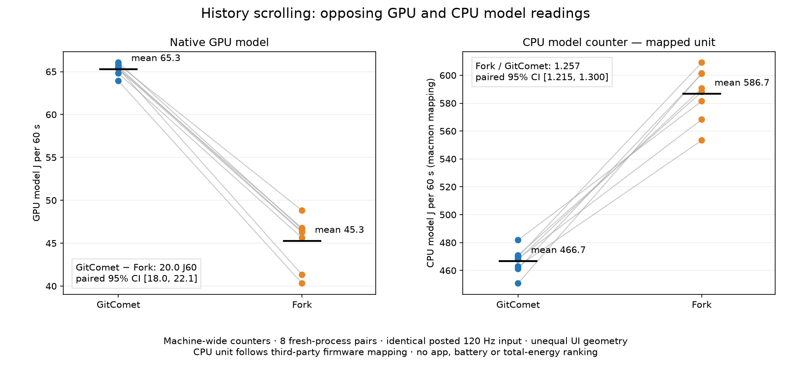

# GitComet and Fork: fixed-input CPU/GPU model comparison

On this M5 Max, the same posted history-scrolling input produced **higher GPU-model readings in GitComet and higher CPU-model readings in Fork**. All eight pairs agreed in both respective directions. These are opposing component differences; they do not establish an overall energy-efficiency winner.



| Primary, normalized to 60 seconds; eight fresh processes per app | GitComet mean | Fork mean | Paired Fork minus GitComet mean [95% CI] |
|---|---:|---:|---:|
| Native GPU model, J60 | 65.28 | 45.26 | −20.02 [−22.09, −17.96] |
| CPU model counter, J60 **as mapped** | 466.66 | 586.68 | +120.02 [+101.53, +138.51] |

The paired CPU counter ratio, Fork/GitComet, is **1.257 [1.215, 1.300]**. That ratio does not depend on a common positive CPU unit scale. It is a machine-wide counter ratio, not app CPU utilization or app energy attribution.

**Main-process CPU time was similar:** 39.32 versus 39.60 CPU seconds over approximately 127 seconds between same-PID snapshots, rather than the primary 60-second window. Do not attribute the 25.7% machine-wide counter difference to the app's own CPU time. Compositor and child-process CPU were not integrated; CPU time does not capture core type or frequency.

Intervals use eight adjacent paired run differences and Student t with seven degrees of freedom; the CPU ratio uses paired log ratios. These exploratory intervals describe one serial series on one machine, not independent machines or guaranteed independent temporal errors. All 16 run values are retained.

GitComet's GPU-model reading is about **44% higher**, but the absolute difference is **20.02 model J60**, equivalent to **0.334 model W** over the measured interval. GPU utilization percentages are not power; utilization was not measured here. Neither battery, display, socket power nor total-system energy was measured here.

These are **machine-wide modeled counters**, including application, compositor, background and measurement work. The native AGX GPU channel reports nJ metadata. CPU names/units come from the firmware-derived descriptors in [macmon 0.11.0](https://github.com/vladkens/macmon/tree/08653ddeb3c1206b6cc35d5a2bb442b4c64ad810), not an API-declared CPU unit or independent physical calibration. The two apps' rendered output was not equivalent; actual presentation cadence was not measured in this study.

## What was compared

- Installed GitComet combined release, source `fe34d0636fe35af0ccbc693ce2b0861499a003c9`, binary SHA-256 `f3172102f1b0b9722424ea991ee229a51396ee43a87cffaabcd4adc36b9455c3`, private GPUI base `4b3b9c5`. This is the user's installed combined build, **not stock GitComet or an isolated PR**.
- Fork 2.71.1, binary SHA-256 `5e2a769758b352aad2e66d1c8607642b1d3b9f37b09475694cdfed9c3eedf8e1`.
- One Apple M5 Max, macOS 27.2 build 26B123, AC, nominal thermal state, Low Power Mode off. Display: 1728×1117 logical points, 2× backing scale, 120 Hz. Both outer windows: 1728×1037 points at (0,34).
- The same 40 repository paths/order and active large history in temporary benchmark profiles. Auto-fetch was disabled in the benchmark configuration. This does not describe the user's normal defaults or measure the full 264-repository session.
- Fixed order `GC,F,F,GC,F,GC,GC,F` twice: 16 original runs, 16 fresh app PIDs, eight adjacent pairs, **no failed main trials and no replacements**. Original 264/44-repository sessions were preserved and restored.

The helper generated pixel-wheel events inserted at session level through `CGEvent.post(.cgSessionEventTap)`: four logical pixels at 120 Hz, alternating direction every five seconds, with the pointer placed at (1000,400) inside the history list. These are generated events, not physical trackpad input. Each fresh process received the same two-second interior initializer, ten-second warmup and settlement. Each 130-second main trial contained 20 seconds still, 90 seconds scrolling and 20 seconds still. The primary endpoints were +35 and +95 seconds; still endpoints were +5/+15 and +115/+125. Actual acquisition midpoint exposure, rather than nominal duration, determines J60. There were 172,800 main posted requests and 2,000 complete counter snapshots across the series.

Launch and posting used the approved ordinary-user SSH context. No screen recording or explicit accessibility inspection ran during main acquisition; GitComet's accessibility state was not independently witnessed. Before/after process, source, profile, repository, foreground, geometry, power and thermal controls were checked. Endpoint checks do not prove continuous background silence.

## Output and instrument checks

Separate recordings before and after main acquisition observed two complete output cycles per app. Post-main observed half-distances were 2395.95/2399.95 logical points in GitComet and 2391.94/2399.94 in Fork; repeat differences were 0.167% and 0.334%. Settled returns agreed within the conservative two-point registration resolution, with no list edge encountered. Both 2,460-frame traces had no rejected adjacent registrations. Recordings were outside every energy window; video geometry is not proof of every main raster frame, native trackpad feel or presentation cadence.

Geometry differed: GitComet rows were 36 points and its history body about 1125×882 points; Fork rows were 22 points and its body about 1446×746. Thus the same posted movement did not mean the same number of rows, pixels drawn, frame rate or rendering work. These data do not support per-row/per-frame efficiency claims or a causal AppKit-versus-GPUI conclusion.

The older legacy CPU channel was found frozen on this OS and was rejected, not interpreted as zero energy. The new CLPC method passed a separate fixed diagnostic: increasing one/two/four CPU loads and a GPU scroll response/cross-check. Its first attempt missed a predefined launch deadline; one allowed setup-only retry using unchanged source passed. Two outer launch preflights subsequently stopped before any main app/input/counters because a longstanding system spindump daemon was first misclassified, then its process path was truncated by `ps`. Those failures and source revisions were retained before any comparison values were read.

The final controller distinguishes the dynamically verified idle launchd service from explicitly launched profilers. Per-run daemon wakes are report-only, never a reason to discard or replace a run. Exact metadata, raw/API subtraction, paired-clock bounds and positive CPU/GPU counter deltas over registered windows were checked. Idle GPU zeros were permitted by rule. Whole-window liveness checks do not prove physical integration freshness or exclude partial staleness.

There were **zero fully unchanged ten-second GPU still windows out of 16 per app**. Native GPU deltas were zero in 62/480 GitComet and 64/480 Fork one-second active-core intervals; the separate CLPC GPU cross-check had none. One of Fork's 80 idle-after one-second deltas was zero. These are cumulative-counter update/freshness limits, **not measured frame drops**. The trace plots show interval-ending modeled rates, not independently measured instantaneous electrical power.

Across the 16 primary windows, the native and CLPC GPU raw endpoint totals differed by at most 2.75% relative to the native GPU total. This is diagnostic agreement between model channels, not physical calibration or proof of endpoint freshness.

The system spindump daemon accumulated zero centiseconds at `ps` resolution across every full runner. Mean own-process CPU percentages of one core, GitComet/Fork, were driver 0.323/0.166%, collector 0.202/0.151%, and runner parent 0.982/0.816%. These roles have different accounting spans: they remain included in the machine-wide measurements and are not added together, subtracted or converted to energy. Separately, same-main-PID `ps` snapshots recorded mean 39.32/39.60 CPU seconds between approximately +1 and +128 seconds. That is not active-core-only CPU or an integral of all child processes. Per-run metadata is in `independent-numeric-review.json`.

## Still windows and conditional arithmetic

| Across eight runs: mean of per-run model W | GitComet before / after | Fork before / after |
|---|---:|---:|
| CPU counter, as mapped | 2.081 / 1.878 | 2.791 / 2.494 |
| Native GPU model | 0.0484 / 0.0469 | 0.0513 / 0.0577 |

The CPU gap was partly present in still windows. The registered secondary calculation subtracts the exposure-weighted before/after still rate, retaining negative results. Its paired Fork-minus-GitComet differences were CPU **+80.25 J60 [8.71,151.78]** and GPU **−20.43 J60 [−22.43,−18.44]**. The CPU contrast is appreciably noisier than the primary result.

The predeclared, **CPU-unit-conditional** CPU+GPU arithmetic was 531.93 versus 631.93 J60, paired difference +100.00 [80.04,119.95]. Its registered directional gate **failed**, because CPU and GPU component intervals point in opposite directions and the CPU scale is not independently established. This arithmetic is reported for completeness and cannot establish lower total energy in either app. ANE and the separate CLPC GPU cross-check are not added to the sum. The supplementary three-panel plots include this conditional sum as a secondary panel; it is not a winner panel.

## Reproduction and corrections

All 16 raw energy files are copied byte-for-byte, with hashes, per-run endpoint/exposure data, all pair contrasts and traces. The portable reproducer validates raw counter identities and arithmetic, rebuilds the numerical results using the frozen pure analyzer and regenerates the figures. Python 3 and Matplotlib are required for graph generation. From this directory, choose a new output directory outside the packet:

```sh
python3 -B recompute.py --output ../energy-recomputed
```

The independent replay produced identical numeric JSON, CSV and all four PNGs. A separate arithmetic implementation verified 9,802 comparisons, including exact rational endpoint exposures and counter differences, with maximum floating-point difference 5.7×10⁻¹⁴. The source/raw inventory is `SHA256SUMS`. Exact acquisition source is included under `source/acquisition/` for provenance; private profiles/configurations, repository identities, app logs and recordings are omitted. Numeric replay does not recreate acquisition or claim independent acquisition replication. Run only `recompute.py` for replay; the acquisition sources are not a portable setup.

This study **supersedes the earlier confounded GPU comparison** in [the 2026-11-09 resource dataset](https://github.com/wowlocal/GitComet/tree/55406d0c4683dc45265faddc8101522279397f82/benchmarks/2026-11-09-fork-gitcomet-generated-scroll). Its whole-GPU medians, 0.404 W for GitComet and 0.953 W for Fork, had different window coverage and elevated desktop/Fork idle baselines. They were not valid app energy-efficiency evidence and must not be combined with this new workload. The replacement result has the opposite GPU direction and separately reports the CPU counter.

The earlier dataset's CPU percentages were main-process utilization under a different generated workload, not this study's machine-wide CPU model counter. Those metrics cannot be substituted for one another.

The isolated before/after evidence for [PR #749](https://github.com/Auto-Explore/GitComet/pull/749) remains a [separate 40-run CPU/presentation study](https://github.com/wowlocal/GitComet/tree/31556a9c0c646a186b781c7783ba741f8a6bf2c5/benchmarks/2026-11-10-pr749). It cannot be assigned an energy saving from this installed-build comparison. Related proposals are [elastic scrolling #742](https://github.com/Auto-Explore/GitComet/pull/742), [fractional history alignment #747](https://github.com/Auto-Explore/GitComet/pull/747) and [momentum retiming #748](https://github.com/Auto-Explore/GitComet/pull/748); none is isolated by this study.

AI assistance: OpenAI Codex implemented, acquired, analyzed and performed agent reviews. Claude Fable 5.2 provided methodological and wording reviews of supplied summaries and report text, without direct raw-data or packet access. Source, acquisition, geometry, arithmetic and privacy reviews were automated agent reviews, not human review. One machine and one acquired series; no claim of independent acquisition replication.
