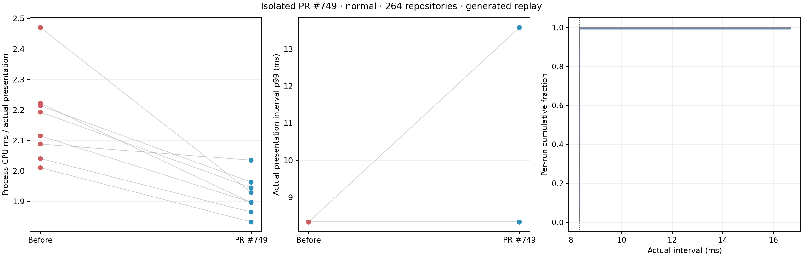
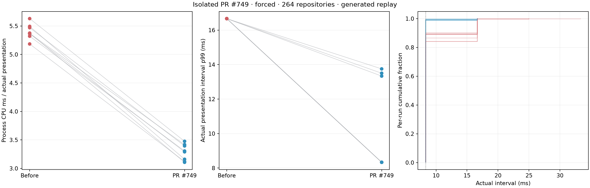

# PR #749: exact before/after measurements

On one M5 Max, PR [#749](https://github.com/Auto-Explore/GitComet/pull/749) reduced root-process CPU per actual presentation with common recording enabled. With GPUI's accessibility core path forced, it also improved presentation cadence. With accessibility inactive, cadence showed no detectable change; the smaller recorder-off CPU control was inconclusive.

| Condition | Run pairs | Endpoint | Base → #749 | Mean paired difference (95% CI) |
|---|---:|---|---:|---:|
| GPUI accessibility forced; native recorder on | 8 | CPU ms / actual presentation | 5.40 → 3.28 | −2.117 ms [−2.224, −2.010] |
| Same forced condition | 8 | Intervals longer than 12.5 ms | — | −11.44 percentage points [−13.58, −9.30] |
| Accessibility inactive; native recorder on | 8 | CPU ms / actual presentation | 2.17 → 1.92 | −0.249 ms [−0.367, −0.130] |
| Accessibility inactive; native recorder off | 4 | CPU as % of one core | 27.24 → 24.10 | −3.14 percentage points [−8.26, +1.98] |

These are separate conditions, not pooled results. Forced mode requests GPUI accessibility processing once before warmup and verifies advancing tree counters; equivalence to VoiceOver or a native external accessibility client was not measured. Input is an in-process programmatic replay, on one Mac and one 264-repository profile. These measurements do not establish energy savings, physical trackpad feel, the installed combined build's behavior, or a ranking of the other PRs.

## Before/after graphs

Each line connects one matched run pair. Red is the exact base; blue is #749. The ECDF shows each run separately.

In forced mode, p95 fell from two display-refresh periods to one, approximately 16.67 → 8.33 ms, in all eight pairs. The extremely narrow numerical p95 confidence interval in the saved analysis reflects refresh quantization, not sub-microsecond measurement precision. Mean paired p99 fell by 6.39 ms (95% CI: 4.14–8.63 ms). Three treatment runs still had p99 gaps between 13.33 and 13.75 ms.

In normal mode, one treatment run had p99 = 13.58 ms, versus approximately 8.33 ms in every base run. The paired p99 and long-gap-fraction confidence intervals include zero. A small cadence regression is not excluded; reduced CPU does not establish a visible cadence gain.

## Source, workload and endpoints

Before: GitComet `14b3cba1a8fcd51ae6a32e8bbc385556625bf5b2`. After: #749 at `7b0229c82a09383a3cada51834dde4decc9aa7b4`. Both use public GPUI `c55d73659dd6560d3e70281056f841e6d366c0e5` plus an identical local native-timing observer patch, and identical reviewed app-side replay/witness overlays. Neither contains the elastic-scrolling, indexed-row, momentum-retiming or GPUI #47 changes. Rust 1.99.1, locked dependencies, release optimization (opt-level 3, fat LTO, one codegen unit), signing and input were held constant. Worktree paths differ and may affect binary layout, particularly relevant to the smaller normal-condition CPU difference. [Exact identities and hashes](data/sources/identity.json), [build records](data/sources/builds.json).

Machine: Apple M5 Max, Mac17,6, system-reported macOS 27.2 (26B123), built-in 120 Hz display at 3456 × 2234 physical pixels. Window: 1728 × 1037 logical points. AC power, nominal thermal state, Low Power Mode and Reduce Motion off. No builds, games, sampling profiler, video recording or accessibility inspection during the main runs.

Each native-recorder condition used 16 fresh processes in ABBA BAAB ABBA BAAB order, giving eight adjacent A/B run pairs. All 32 main runs passed the predeclared controls, with no invalid main attempts or replacements. Each used the same 240-packet wheel plan, two warmups and four measured alternating replays. Eight fixed sustained-motion windows give 4.601196 seconds of cadence exposure per run. No windows were selected using frame outcomes.

Actual drawable presented-time callbacks supply cadence. The CPU endpoint divides root-process cumulative CPU increments by actual presentations over the same counter-observed replay envelope, including gaps between replays. It is not render duration or energy; it excludes child-process and WindowServer CPU. All 32 CPU joins passed their clock bounds: maximum endpoint uncertainty 0.102 ms, and count-bound width at most one presentation.

Run pairs, not individual frames, supply exploratory per-endpoint 95% Student t intervals. These are not simultaneous confidence statements. The [frozen pre-capture method](data/method/PREREGISTRATION.md) defines endpoints, within-build variation checks and the directional gate. Gate outcomes, all run values, paired differences and callback/dispatch outcomes are in the saved analyses.

The method and analyzer were frozen before the sampled normal pilot, the forced positive-control pilot and the first main-series run. Both pilots were excluded from main statistics by plan and retained locally, outside this public packet. An earlier stock-binary gate failed on a locked screen before replay and was retained separately. Three additional post-series access-route checks were also excluded and retained locally; they are not main-series invalid attempts or replacements.

## Recorder-off control and observation limits

All eight planned recorder-off runs passed, with no invalid attempts or replacements: ABBA BAAB, four adjacent pairs. The common application probe and 1 Hz process observer remained enabled. There is no actual-presentation denominator in this control. [All eight CPU records and calculation](controls/README.md).

The recorder-off control did not independently replicate the normal CPU benefit: its CPU-over-time interval crosses zero. It neither confirms nor contradicts the recorder-on result. Recorder-on and recorder-off acquisition occurred in separate time epochs, without randomized observer allocation, so this does not provide the planned causal estimate of recorder overhead. A recorder-by-build interaction is not excluded in either native-recorder condition. There is no fully uninstrumented replay control or forced-mode recorder-off control.

A separate sampler-perturbed normal pilot on the base build found zero named tab-stack matches among 2,714 sampled main-thread stacks, against a nominal 5,000 requested samples. Inlining and main-thread-only sampling limit attribution. These results establish a build difference under the stated conditions; they do not identify the exact function responsible for all CPU savings.

## Data and verification

The [v2 saved-data packet](data/README.md) includes all 32 main runs, actual presentation traces, allowlisted CPU/control records, input plan, source overlays and the unchanged frozen analyzer. Run `python3 reproduce.py` inside `data/` to verify its complete inventory and recompute the saved outcomes. Independent automated runtime review regenerated both analysis JSON files exactly and both PNGs byte-for-byte. A separately implemented automated calculation audit recomputed raw counters, clock joins, fixed windows, quantiles and paired intervals and matched every specified result. That audit was not blinded to the normal-arm aggregate. The recorder-off CSV was separately audited against its eight local raw records.

Private repository/session details are omitted. Native trace bytes and all numerical outcomes are preserved. Packet inventory SHA-256: `7e89de182518fa1fcf2eca366ce0ee053b1bba82e09766455eba90876f0201db`. The independent automated runtime review checked 47,856 retained frame records, 347,920 native records, file inventories and private-identifier redaction. This is an audit of saved evidence, not an independent acquisition replication.

## Corrections and unfinished work

- The earlier claim that #749 was the biggest contributor to the installed build's smoothness is withdrawn. This comparison isolates #749 and cannot rank the other changes.
- The pilot expectation of a normal-condition CPU null was contradicted by the recorder-on series; that expectation was not used to change the capture or analysis plan.
- Recorder-off runs did not achieve the pre-registration's intended causal estimate of recorder overhead, for the reasons above.
- A Fable review prompt misstated cadence exposure as approximately 4.6004 seconds; the source-defined exposure is 4.601196 seconds. Capture windows and computed outcomes were unchanged.
- The first export failed inventory validation because the exporter hashed its own unfinished inventory. It was retained locally and replaced by this independently validated v2 export. Acquisition, analyzer and numerical results were unchanged.
- The Fork-versus-GitComet energy comparison has not run. The fixed native input helper has not passed its OS permission check. Three disposable post-series routing checks showed that accessing the benchmark app through the available computer-control route activated accessibility; a [passive witness from the screenshot-only refresh check](routing-control.json) records the transition. That route would change the intended workload and was not used for energy measurement. No energy-efficiency winner is claimed.

AI assistance: OpenAI Codex for implementation, measurement, separately implemented calculation audits, code/data/privacy reviews and this report. Actual Claude Fable 5.2 on the user's Mini reviewed protocol text, pasted source excerpts and summary numbers supplied in prompts; it did not inspect repositories, raw records, the public packet or linked files, and did not independently verify figures. All these reviews were automated, not human review. This report does not claim that a maintainer has reviewed or endorsed the findings.
